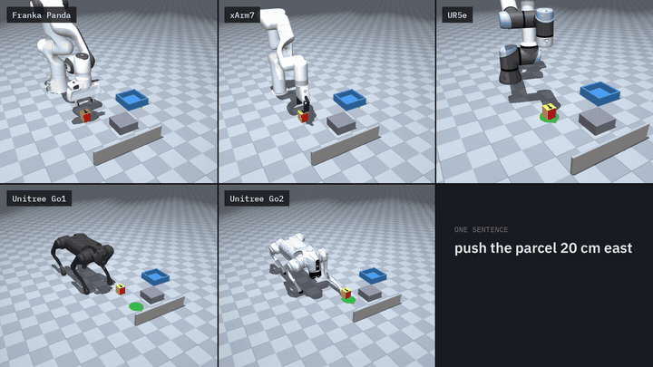
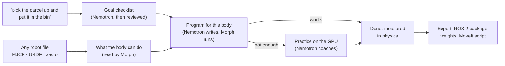

# Morph

**Describe a task once, in plain words. Any robot does it in MuJoCo, with NVIDIA Nemotron reasoning at every step.**



*One sentence, "push the parcel 20 cm east", and five robots with very different bodies each work out how to do it:
two arms with grippers, an arm with no gripper that pushes with its wrist, and two four-legged robots that walk over
and push with a foot. Nobody wrote any of these programs by hand.*

## Why

Getting a robot to do a new task usually means an engineer writing code for that exact robot and that exact task.
Change the arm, swap the gripper, or put it on wheels or legs, and you start again.

Morph turns that around. You describe **what** should happen, in a sentence. Morph works out **how**, for whatever
robot you give it:

* It reads the robot's own model file to find out what its body can do. Nobody describes the robot to it.
* It turns your sentence into a checklist the physics can measure.
* It gets the robot there with a short program, and practises on the GPU when a program isn't enough.
* **The simulator decides whether it worked, never the language model.** Every result is measured on the physics,
  misses included.

## What happens when you type a sentence



1. **It understands the goal.** Nemotron turns the sentence into a checklist of measurable conditions: where the object
   must end up, which way up or which way it faces, and when each counts (at the end, when the robot lets go, the whole
   time, the last few seconds). A second Nemotron pass reviews it for wrong meanings, and Morph checks it's consistent
   and physically possible in this scene.
2. **It understands the robot.** It reads the robot file itself: its base (bolted down, legged, wheeled, flying), arms,
   legs, gripper and how far it opens, each part it can move, how far it reaches, and its joint limits.
3. **It tries a program first.** Nemotron writes a short recipe from building blocks that suit that body. Morph runs it
   in physics, says what went wrong in concrete terms (*"the fingers closed on nothing: the parcel is 3 cm from the
   point between them"*), and Nemotron fixes it, up to 5 times. Often that's enough.
4. **It learns when a program isn't enough.** Reinforcement learning on the GPU, with thousands of copies practising at
   once. It starts from the working program where there is one; between rounds, Nemotron reads what the robot
   actually did and revises the plan. You can coach it while it learns.
5. **It exports the skill** as NumPy weights with a standalone runner, a **ROS 2 package** (a node for the real robot
   plus a simulated stand-in), and, for scripted arm runs, a **MoveIt** script.

## Results

Measured on 2026-10-03 with the commands under [Reproduce](#reproduce). *n* tries each from slightly different
starts (object ±2 cm, ±10°, varied mass and friction).

**Programs, one sentence in, Nemotron on** (`morph do`, 4 tasks × 6 robots):

| Task | Franka Panda | UFactory xArm7 | UR5e (no gripper) | SO-ARM100 (5-joint wrist, 41 cm reach) | Unitree Go1 | Unitree Go2 |
|---|---|---|---|---|---|---|
| Put the parcel into the bin | **5/5** (ready-made skill) | **5/5** (ready-made skill) | can't lift *(reported)* | 0/5: bin out of reach | can't lift *(reported)* | can't lift *(reported)* |
| Lift it 10 cm and hold it | 2/5 | **5/5** | can't lift *(reported)* | 0/5 | can't lift *(reported)* | can't lift *(reported)* |
| Knock it over | **5/5** | **5/5** | 0/5 (tilted it 34° at best) | 0/5 | 2/5 | 0/5 |
| Push it 20 cm east | **5/5** | **5/5** | **4/5** | 0/5 (11 cm at best) | **4/5** | **4/5** |

"Can't lift" cells are physically impossible for that body (no gripper, or no arm), and Morph says so before trying.
Of the 18 possible cells, 12 succeeded at least once and 10 succeeded 4/5 or 5/5; every program was written by
Nemotron within 5 attempts, from the sentence alone. Programs: 2–5 Nemotron calls each, about $0.01 per robot.

**Learning on top of a program**, end to end with Nemotron (`morph learn`, xArm7, "lift the parcel 10 cm off the
ground and hold it there", 10 tries): Nemotron's third program worked 8/8 on the arm it was written for, but
replayed move for move in the learner's GPU physics its grasp slips (that physics has no anti-slip contact solver).
Copied as is: **0/10**. After one practice round of corrections (10M steps, easy-first, about 8 min on a laptop
GPU): **10/10**.

With a hand-written program (no Nemotron), the copy alone already succeeded: lift 10/10, put it in the bin 10/10.

**Why learn when the program already works:** the lift skill with the parcel knocked mid-task (it slides about 4 cm,
a quarter of the way through), 10 tries each:

| Knock | Program alone (hand-written) | Learned skill | Nemotron's program alone | Learned from it |
|---|---|---|---|---|
| 0.7 m/s at 20% of the way | 3/10 | **8/10** | 0/10 | **8/10** |
| 1.0 m/s at 20% | 1/10 | **6/10** | 0/10 | 1/10 |
| 0.7 m/s at 35% | 3/10 | **9/10** | 0/10 | **9/10** |

A program follows fixed moves; the learned skill sees where the object is and corrects. The app runs this test with
one click (Robot tab → *Test it: knock the parcel mid-task*).

**Understanding requests:** `morph goal-bench`, 27 varied requests judged on example outcomes (throwing from a spot,
gentle placing, "first the shelf, then the bin", lying on its side by the wall, …): **Nemotron 27/27**. Morph's own rule
reader, without Nemotron: 13/26 on the earlier 26 cases.

## Quick start

Tested on Ubuntu 24.04 (WSL2), Python 3.12, an RTX 5070 Laptop GPU (8 GB) for learning. Programs and everything
except learning run on a CPU.

```bash
python3 -m venv .venv
.venv/bin/pip install -r requirements.lock
.venv/bin/pip install --no-deps -e .
./scripts/fetch_assets.sh --extra      # MuJoCo Menagerie robots at a pinned commit (licenses in each folder)
cp .env.example .env                   # then put your Nebius Token Factory key in .env (git-ignored)
.venv/bin/morph check-llm              # checks the key, and that Nemotron is served
.venv/bin/morph app                    # opens http://localhost:8765
```

For learning, a second environment with JAX on CUDA:

```bash
python3 -m venv .venv-rl && .venv-rl/bin/pip install "jax[cuda12]==0.11.2" && .venv-rl/bin/pip install -r requirements-rl.lock
```

If your shell sets `PYTHONPATH` (e.g. ROS), run commands with `env -u PYTHONPATH`.

### Your first five minutes

1. Run `morph app` and open http://localhost:8765.
2. Pick the **parcel** scene, tick **Franka Panda** and **Unitree Go2**, and type `push the parcel 20 cm east`.
3. Press **Run.** Watch the checklist appear, then each robot try. Every try lands as a square: green worked, red didn't.
   Click any square to replay it.
4. Open the **Robot** tab to see what Morph found in each robot, where it stands (move it by typing or clicking the
   view), and the plan it followed.
5. Try something harder: `pick the parcel up and put it in the bin`, then **Learn this task** on a robot that
   struggles. The **Learning** tab shows each round, what it's practising, and a box to type advice ("it closes the
   gripper too early").

The view orbits, pans and zooms (⟲ resets it), and a compass in the corner shows which way is north as you turn it.

### From the command line

```bash
.venv/bin/morph do examples/parcel "put the parcel into the bin" --robot third_party/mujoco_menagerie/universal_robots_ur5e/ur5e.xml
.venv/bin/morph do examples/ball "put the ball into the bin"          # a real sphere: it rolls
.venv/bin/morph do examples/pen "put the pen into the bin"            # a 3D model (Pen.STL)
.venv/bin/morph learn examples/parcel "lift the parcel 10 cm and hold it" --robot <model.xml> --rounds 4
.venv/bin/morph export runs/learned/<robot>__<goal>                    # policy + runner + ROS 2 package
.venv/bin/morph video runs/learned/<robot>__<goal>                     # render learning videos
.venv/bin/morph inspect <model.xml|.urdf|.xacro>                       # what Morph sees in a robot
.venv/bin/morph goal-bench                                             # does it understand varied requests?
```

Add `--run 5` to try a task 5 times from slightly different starts, and `--video` to save each try as an mp4.

## Things you can ask for

Directions are compass directions on the floor: east is +x, north is +y.

| You type | Morph checks |
|---|---|
| `push the parcel 20 cm east` | its centre ends 20 cm east of where it started (±2 cm) |
| `pick the parcel up and place it into the bin` | it ends inside the bin, and it was held at some point (not shoved in) |
| `put the parcel on the shelf facing north` | on the shelf, turned to face north |
| `lift the parcel 10 cm and hold it there` | lifted 10 cm, and kept there |
| `throw the parcel into the bin from 1 m north of it` | let go from that spot, and lands in the bin |
| `knock the parcel over` | lying on its side at the end |
| `spin the pen around the fingers without using the thumb` | it turns, never falls out of the hand, and the thumb never touches it |

## Bring your own robot, scene or object

* **A robot:** any MJCF, URDF or xacro file (ROS packages next to it are found). `morph inspect <file>` shows what
  Morph sees in it: type, size, reach, gripper and motors. Torque motors become servos; floating models are stood on
  the floor.
* **A scene:** a folder with a MuJoCo `scene.xml` (one object to move, plus anything else: bins, shelves, walls) and a
  `morph.toml` naming the object. See `examples/parcel/`. The app can also upload one.
* **An object:** `morph object <model.stl|.obj>` puts a 3D model into the work cell as a new scene (`examples/pen`
  holds a pen from an STL file).

## How it works

### 1. The goal: a checklist, not a target pose

Conditions Morph can measure on the simulation: inside / on top of / touching / near / beside a fixture (or not),
at a position, facing a heading, which face is up, lifted to a height, moved N cm in a direction, away from something,
plus any formula over measured quantities (`x`, `y`, `z`, `tilt_deg`, `speed`, `spin_dps`, `held`, `dist_to('bin')`,
…). Each can say *when* it must hold: `end`, `release` (throwing, dropping), `always`, `ever`, or `last` (the last N
seconds without a break: keep it spinning, keep it balanced). "Held" is decided from real contacts: touched from two
opposite sides and nothing else carrying it. Formulas can also look back over time, for what one moment can't show:
`change(yaw_deg, 4)` is how far it turned in the last 4 s (through whole turns, so shaking it back and forth adds up to
about nothing, while a speed like `spin_z_dps > 180` is met by a fast shake too), `change(q)` since the try began, and
`mean(q, s)` an average or, for a condition, the share of the time it held (`mean(touching('thumb'), 2)`). The judge
and the learner follow them through each try the same way.

### 2. Programs: building blocks for each kind of body

| Body | Building blocks | Runs on |
|---|---|---|
| Arm with a parallel gripper | `move_hand` (hand pointing down, lined up with the object), `open_hand`, `close_hand`, `throw_to` (Morph does the wind-up and swing and corrects the aim from where practice throws land), `wait` | the arm's own IK and gripper, grip strength found by a test pick |
| Any robot that stands still (arms without a gripper, hands, other grippers) | `move` *any part* to a point, pointing any way (`down`, `east`, `object`, or a vector), fingers turned across the object; `push`; `grip`; `joints`; `home`; `wait` | damped least-squares IK on the learner's own model; joint-space swing when the straight path hits a joint limit; grip strength found by measuring the squeeze |
| Legged robots with a learned gait (Go1, Go2) | `walk_to`, `turn_to`, `foot_push` (low slides it, high pushes near its top), `bump` (with the body), `push_object_to` (Morph plans a series of pushes) | the robot's walking policy, three-leg stance for the foot push |

All of them are reactive: `until: "touch"` stops a move on contact, and `repeat_if(condition, back_to, times)` goes
back if something didn't work ("if `held == 0` after lifting: grasp again"). Numbers can be formulas over where things
are when the step starts (`obj_x`, `obj_top + 0.05`, `bin_x`, `hand_z`, …), so a program follows the object.
Programs are JSON data, never code. Working programs are cached, so a rerun makes no new Nemotron call.

### 3. It learns when a program isn't enough

The robot practises in thousands of copies of the simulation at once (MuJoCo Warp + Brax PPO). The main ideas:

* **Start from the program:** the learner adds corrections on top of the program's moves, so doing nothing *is* the
  program, and practice refines it instead of starting from zero.
* **The plan is the reward:** Nemotron writes the steps a person would take with this body ("line the fingers up
  around it, close, lift, carry, lower it in"), and the robot is rewarded for reaching each in order. Morph checks
  every plan before practice and sends a flawed one back with the reason (a step that can never be done, steps out of
  order, closing before the object is between the fingers).
* **Nemotron coaches between rounds** (Eureka-style): Morph replays the robot, measures where it gets stuck and what it
  actually did, and Nemotron revises the plan. A revision is only kept if it practises better than the plan it
  replaces.
* **You can coach it too:** type what you see it doing wrong, or rate a practice try 👍 / 👎. Nemotron turns your
  words into a revised plan, and Morph races it against the current one before keeping it.
* **Easy first, then harder:** early practice starts close to success (already holding it, nearly there) and moves
  back each round; varied friction, weight, motor strength, noise and delays come in once it first succeeds.
* **Nothing learned is lost:** the best version so far is always kept, across rounds and within one.

The full list, with the failure behind each method, is in **[docs/learning.md](docs/learning.md)**.

### 4. Exports

* **Standalone:** `policy.npz` (NumPy weights), `policy.json` (exactly what it reads and outputs, joint order, rates,
  the program it corrects), `model.xml` with its meshes, and `run_policy.py`.
* **ROS 2** (`ament_python`): `policy_node` subscribes to `joint_states` and the object pose (and odometry for mobile
  robots) and publishes `JointTrajectory` or `Float64MultiArray` commands; `sim_bridge` is a MuJoCo stand-in that speaks
  the same topics; `ros2 launch <pkg> policy.launch.py sim:=true`. Tested: the node rebuilds the training observation
  exactly, and the closed loop reaches the goal through ROS topics.
* **MoveIt:** for scripted arm runs, a `moveit_py` script with the grasp and place waypoints in the robot's base frame.

### 5. Videos

Tries are recorded as simulation state (not frames) and rendered to mp4 on demand, since rendering is slow under WSL
(~30 s per try). Videos are 1280x720, real time, with captions and the result at the end.

* `morph do ... --video` saves `<out>/videos/<robot>/try_NN.mp4`.
* `morph learn` saves each round's policy in `rounds/` and renders `round_N.mp4`, `final.mp4`, `compare.mp4` (program
  vs learned policy with the object knocked mid-task) and `learning_progress.mp4` into
  `runs/learned/<robot>__<goal>/videos/`. `morph video <folder>` does the same for an existing skill
  (`--list`, `--clip round_2`).
* In the app, any result square can be replayed and downloaded, and the **Videos** button lets you pick several and
  download them as one mp4 or a zip.

### 6. Hands

Morph finds hands in any model (on an arm or on their own) and labels the fingers from their names, or from the hand's
shape when the names don't say. Goals can say which part touches the object (`touching('thumb') == 0` the whole time,
`fingers_touching >= 2`), and in-hand requests ("spin the pen around the fingers") start with the object already in
the hand, in a grip Morph has tested to hold. Details in [docs/learning.md](docs/learning.md#hands).

## How NVIDIA and Nebius are used

* **Model:** NVIDIA Nemotron (`nvidia/nemotron-3-super-120b-a12b`, configurable with `MORPH_NEMOTRON_MODEL`), an
  NVIDIA open model, called through the **Nebius Token Factory** OpenAI-compatible API.
* **What Nemotron does** (none of it in the control loop):
  1. reads the request into a goal checklist, and reviews its own reading for wrong meanings;
  2. plans the steps a person would take with this body;
  3. writes programs from building blocks and fixes them from Morph's step-by-step report;
  4. coaches learning: reads what the robot actually did, rewrites the steps and reward terms, proposes alternative
     plans when progress stalls, and turns a person's advice into a revised plan.
* Every reply is schema-validated (pydantic), every formula is parsed by Morph's own safe evaluator (no `eval`), and
  invented names, unknown building blocks or impossible numbers are sent back with the reason. A wrong answer costs a
  retry, never a crash. Every call is logged with model, latency and tokens (`runs/app_inference.jsonl`), never the key.
* **GPU:** learning runs on NVIDIA GPUs through JAX and MuJoCo Warp (local, or a prepared Nebius AI Cloud job).

## Compute and cost

| Item | Measured | Cost |
|---|---|---|
| Nemotron (Token Factory, $0.30 / $0.90 per 1M input / output tokens, read live from `/v1/models`) | goal + review: 2 calls; a program: 1 call per attempt; a learning revision: 1 call | about $0.002–0.01 per call; a full `morph do` with programs: a few cents |
| Learning one skill (60M practice steps, 4 rounds) | local RTX 5070 Laptop, 512–1024 copies at once | about 30–40 min, no bill (about $0.05 of electricity) |
| Same on **Nebius AI Cloud** (option) | H100 / H200 / B200; prices change on 2026-10-01, Morph shows the right one by date | about $1–3 per skill; Morph prepares the job, you start it |

## Robots and assets

Any MJCF, URDF or xacro. Tested with these MuJoCo Menagerie models (`scripts/fetch_assets.sh --extra`, pinned commit
`c96a32d`): Franka Panda, UFactory xArm7 and Lite6, AgileX Piper, Kinova Gen3, UR5e, SO-ARM100, Unitree Go1, Go2, H1
and G1, ANYmal C, Spot with arm, Skydio X2, Hello Robot Stretch, Shadow Hand and Allegro Hand.

Walking policies are included for the Go1 (`artifacts/go1_walk/`), the Go2 (`artifacts/walk/go2/`) and Spot
(`artifacts/walk/spot_arm/`); `morph app` can train one for another legged robot (learning a task trains one first
when the robot needs to walk to where it works). Walking practice moves only the legs, and its effort, speed and foot
penalties are measured for the robot's own size and motors.

## Project layout

| Path | What's there |
|---|---|
| `morph/cli.py` | the `morph` command |
| `morph/app/` | the browser app (server and single-page interface) |
| `morph/goals.py`, `goal_terms.py`, `goal_sources.py` | reading a request into a checklist, and measuring it |
| `morph/introspect.py`, `robot_import.py`, `fingers.py` | reading a robot file: body, gripper, hands |
| `morph/programs.py`, `body_programs.py`, `legged_programs.py` | the building blocks and running programs |
| `morph/learn_task.py`, `plan_check.py`, `skill_steps.py` | learning in rounds, plan checks, Nemotron's steps |
| `scripts/train_task.py`, `train_walk.py` | the GPU trainers |
| `morph/ros_export.py`, `moveit_export.py` | exports |
| `examples/` | ready scenes: `parcel`, `ball`, `pen` |
| `tests/` | the test suite |

## What this is not, and known limits

* A simulation workbench: it reads simulator ground truth (no perception) and has no real-robot validation. The ROS 2
  export is meant as a starting point to fine-tune on hardware.
* Programs can't express everything: dexterous in-hand skills (spinning a pen), balancing, catching. Those need
  learning from scratch, which is much less reliable and needs far more compute. In-hand goals do start in the hand
  and are judged per finger (see Hands), but a 20 min test run on the Shadow Hand only got as far as keeping the
  pencil and turning it at 163°/s, with the thumb still touching it.
* Learning hard tasks from scratch on a mobile robot is slow: a Stretch practising "put the parcel in the bin facing
  west" with no working program learned the pick-up and drop from one of its ten starts in about 2½ hours, but not
  the turn.
* Robots with detailed collision shapes (the Stretch) run out of memory on an 8 GB GPU at 1024 copies; Morph drops to
  512, which is slower.
* Humanoids and robots without a walking policy get no programs yet; learning from legged programs isn't supported.
* Objects are boxes, spheres, upright cylinders or capsules (other shapes are treated as their bounding box).
* A program's accuracy is limited by its open-loop moves (pushing to within 2 cm is hard); that's what learning
  corrections are for.

## Reproduce

```bash
.venv/bin/python -m pytest -q                       # 223 tests (CPU); the xacro test needs xacro installed
.venv/bin/morph goal-bench                          # request understanding: Nemotron vs rules (~$0.07)
.venv/bin/morph do examples/parcel "<task>" --robot <model> --run 5 --yes   # each cell of the programs table
```

The learning tables use `morph learn` (or the app) on the xArm7, and the knock test is `learn_task.robustness`.

## Related work

* **Eureka** (Ma et al., NVIDIA 2023): an LLM writes reward code and improves it from training statistics; it reached
  expert-level rewards for dexterous skills such as pen spinning, with expert-prepared environments and large GPU
  budgets. Morph's revision loop is Eureka-like, but Nemotron writes checked formulas rather than code, and Morph aims at
  everyday tasks from a sentence, for any robot file, on one GPU.
* **Code as Policies** (Liang et al. 2022), **RoboGen** (Wang et al. 2023), **GenSim** (Wang et al. 2023): language
  models writing robot programs, and using them to make training data. Morph's programs follow this idea.
* **LLM-Modulo** (Kambhampati et al. 2024): a language model's plans checked by outside verifiers, as Morph checks
  Nemotron's plans before any practice.
* **Deep RL from human preferences** (Christiano et al. 2017), **asymmetric actor-critic** (Pinto et al. 2018),
  **DAPG** (Rajeswaran et al. 2018), **residual policy learning** (Silver et al. 2018; Johannink et al. 2019),
  **reverse curriculum** (Florensa et al. 2017), **DART** (Laskey et al. 2017), **DeepMimic** (Peng et al. 2018),
  **DexPBT** (Petrenko et al. 2023), **Sequential Dexterity** (Chen et al. 2023), **Prioritized Level Replay** (Jiang et
  al. 2021) and **automatic domain randomization** (OpenAI 2019): the learning methods in
  [docs/learning.md](docs/learning.md).

## The original transfer pipeline

Morph started as demonstration transfer: a Panda demonstrates, Morph records what happened to the object and has a
robot with a different body reach the same outcome. It's still here (`morph transfer`, `morph view`, `morph showcase`,
`morph eval`):

| What (measured 2026-09-28) | Result |
|---|---|
| Panda-trained task-space policy, zero-shot on the xArm7 | 48/50 (joint-space / raw replay baselines: 0/50, 0/50) |
| Generated arm A → arm B (49% longer upper arm): task-space / joint policy / replay | 47/50 / 33/50 / 0/50 |
| Arm → arm-free mobile pusher (closed-loop push planning) | 26/30 (baselines 2/30, 2/30) |
| Arm → Unitree Go1: learned walking (RL, ~20 min) + foot pushing | 12/16, 0 falls (hand-written crawl: 0/8) |

```bash
.venv/bin/morph transfer                     # Panda demo -> Nemotron -> confirm -> strategy -> xArm7 -> verify
.venv/bin/morph view --robot go1             # live 3D window
.venv/bin/morph eval -n 50 --source franka_panda
```

## Third-party code and licenses

This repository is Apache-2.0 (`LICENSE`). It builds on:

* [MuJoCo](https://github.com/google-deepmind/mujoco) (Apache-2.0), MuJoCo MJX and Warp.
* [MuJoCo Menagerie](https://github.com/google-deepmind/mujoco_menagerie) robot models, fetched by
  `scripts/fetch_assets.sh` at a pinned commit (not stored in this repo); each model folder holds its license.
* [MuJoCo Playground](https://github.com/google-deepmind/mujoco_playground) (Apache-2.0): its Go1 model is included in
  `third_party/playground_go1/` with its license, and its `Go1Joystick` task was used to train the Go1 walking policy.
* Brax, JAX, Flax, optax (Apache-2.0); PyTorch, NumPy, httpx (BSD-3-Clause); pydantic (MIT); imageio (BSD-2-Clause);
  Pillow (MIT-CMU); xacro (BSD-3-Clause, optional).
* NVIDIA Nemotron via Nebius Token Factory (called over the API; no model weights in this repo).
* The five-robot animation at the top is rendered from Morph's own recorded tries (`morph do --run 3 --video`).
